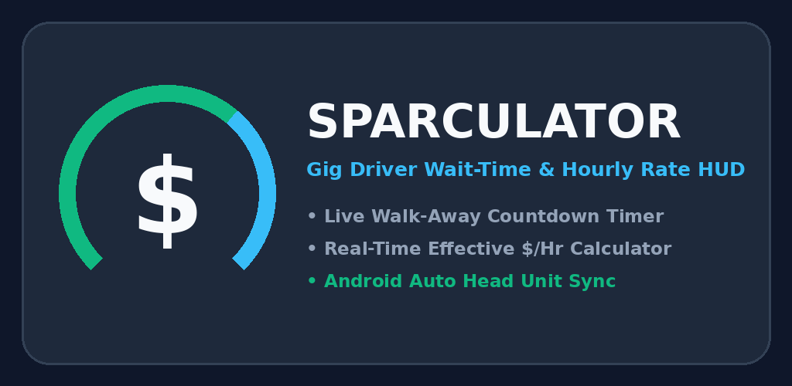
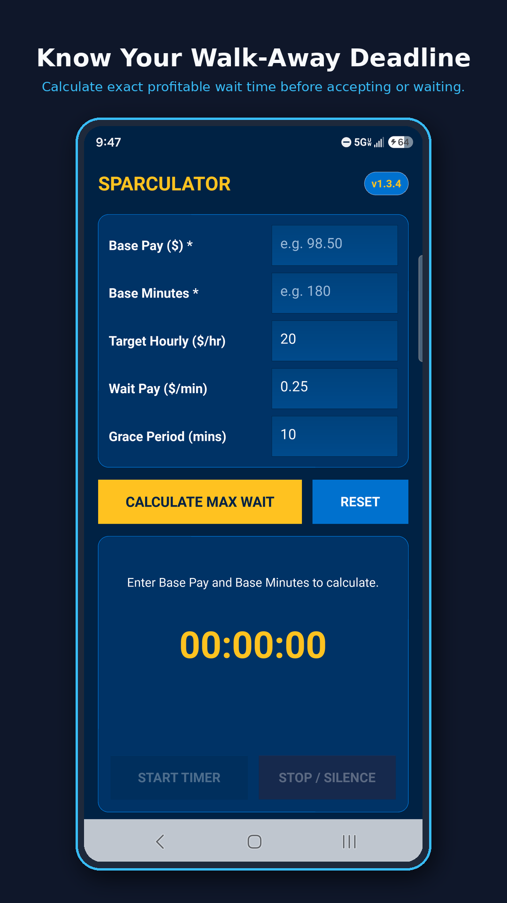
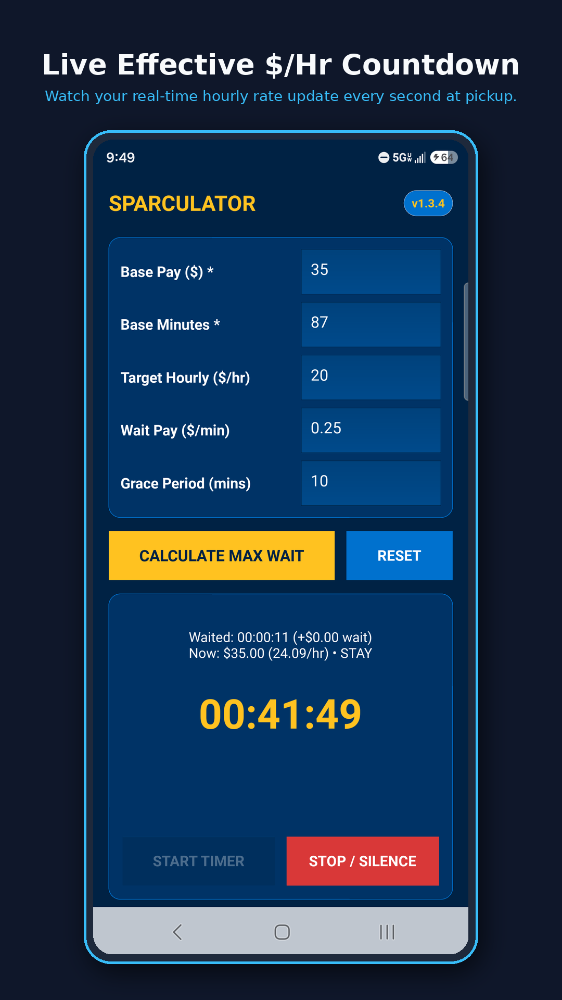
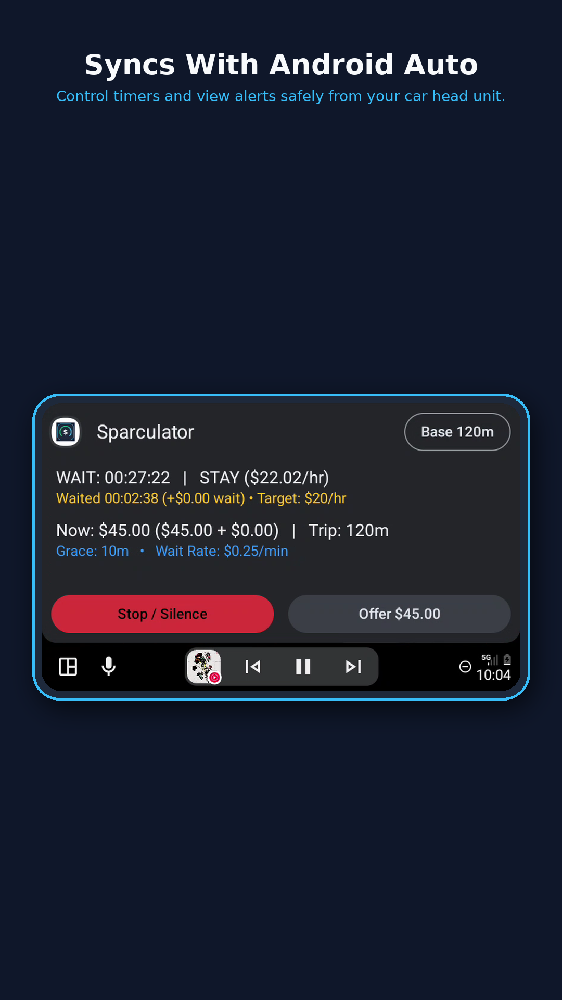

# Sparculator



## Gig Driver Wait-Time Calculator, Effective $/Hr HUD & Android Auto Companion

Sparculator helps independent delivery and rideshare drivers (**namely Spark**) calculate the exact maximum profitable wait time at pickup before their effective hourly rate drops below target—and syncs the live countdown directly to their vehicle's head unit via **Android Auto**.

---

## Screenshots

| Walk-Away Deadline Calculator | Live Effective $/Hr Countdown | Android Auto Integration |
| :---: | :---: | :---: |
|  |  |  |

---

## Features

* **Instant Walk-Away Deadline Calculator:** Computes maximum profitable wait minutes from offer payout, estimated trip duration, target hourly rate, grace period, and platform wait-pay rate.
* **Live Effective $/Hr Countdown HUD:** Updates remaining profitable wait time and real-time hourly earnings second by second while waiting at pickup.
* **Android Auto Integration:** Built on Jetpack Car App Library (`androidx.car.app:app:1.7.0`) to display active countdown timers and accept car-safe keypad inputs on vehicle head units.
* **Phone ↔ Car State Sync:** Shares live offer inputs and active timer timestamps seamlessly between the Kivy phone app and Android Auto via `auto_inputs.json` (`AutoStorageBridge`).
* **Background Foreground Timer & Quiet Vibration Alerts:** Uses an Android `specialUse` foreground service (`ServiceTimerservice`) to keep countdowns accurate while switching apps or locking the screen, triggering tactile vibration alerts when the walk-away threshold expires.
* **100% Local & Private:** Zero cloud accounts, zero ads, and zero analytics or third-party tracking.

---

## Tech Stack

* **Phone UI & Core Logic:** Python 3.14, Kivy 2.3.2, PyJNIus
* **Android Auto Head Unit UI:** Native Java (`SparculatorCarAppService`, `SparculatorCarScreen`, `AutoStorageBridge`) with Jetpack Car App Library `1.7.0`
* **Build Toolchain:** Buildozer / `python-for-android` (SDL2 bootstrap), Android Gradle Plugin `9.0.1`, Gradle `9.1.0` (Configuration Cache + Build Cache), R8 Full Mode
* **Release Automation:** Keyless Google Play Developer API (`androidpublisher` v3) via GCP Service Account impersonation with automatic R8 `mapping.txt` deobfuscation uploads

---

## Project Structure

```text
sparculator/
├── app/
│   ├── main.py                                    # Kivy app entrypoint & animated gauge splash transition
│   ├── assets/
│   │   ├── alarm.wav                              # Fallback audio alert asset
│   │   ├── icon.png                               # Launcher icon (512x512)
│   │   └── presplash.png                          # Static cold-boot splash screen (1080x1920)
│   ├── core/
│   │   ├── __init__.py
│   │   ├── calculator.py                          # Wait-time, effective $/hr & walk-away math engine
│   │   ├── models.py                              # Offer inputs, calculation results & timer state models
│   │   ├── state_store.py                         # Local JSON state persistence & session storage
│   │   └── version.py                             # Single source of truth for app __version__
│   ├── java_src/
│   │   └── com/gigdriverapps/sparculator/auto/
│   │       ├── AutoInputs.java                    # Shared offer & timer data model for Android Auto
│   │       ├── AutoStorageBridge.java             # Shared storage bridge between Python & Android Auto
│   │       ├── AutoTheme.java                     # Color & styling helpers for Car App templates
│   │       ├── AutoWaitCalculator.java            # Native Java wait-time & $/hr math for car UI
│   │       ├── DashboardTemplateBuilder.java      # Car App Dashboard template layout builder
│   │       ├── SparculatorCarAppService.java      # Jetpack CarAppService entrypoint (IOT category)
│   │       ├── SparculatorCarScreen.java          # Primary Android Auto dashboard screen
│   │       ├── SparculatorEditScreen.java         # Car App offer & rate editor screen
│   │       └── SparculatorKeypadScreen.java       # Car-safe numeric keypad input screen
│   ├── p4a_hooks/
│   │   ├── __init__.py
│   │   ├── gradle_patcher.py                      # AGP 9.0.1, Gradle 9.1.0, Java 17 & R8 Full Mode patcher
│   │   ├── hook.py                                # Buildozer / python-for-android lifecycle hook
│   │   ├── manifest_patcher.py                    # AndroidManifest specialUse FGS & Android Auto rules
│   │   ├── paths.py                               # Platform directory finder & Java source sync helper
│   │   └── proguard-rules.pro                     # R8 keep rules for Kivy, SDL2, PyJNIus & Car App IPC
│   ├── platform_android/
│   │   ├── __init__.py
│   │   ├── bridge.py                              # PyJNIus Android bridge, permissions & service control
│   │   ├── notifications.py                       # Android notification channel & alert builders
│   │   └── notifier.py                            # Tactile vibration & expiration alert dispatcher
│   ├── res/
│   │   └── xml/
│   │       └── automotive_app_desc.xml            # Android Auto template capability descriptor
│   ├── services/
│   │   ├── __init__.py
│   │   ├── auto_inputs_sync.py                    # Background file watcher & state sync helper
│   │   └── timer_service.py                       # Android specialUse foreground countdown service
│   └── ui/
│       ├── __init__.py
│       ├── auto_sync_bridge.py                    # UI-to-Android Auto storage sync coordinator
│       ├── input_form.py                          # Offer & rate input validation and form controller
│       ├── kv/
│       │   ├── main_screen.kv                     # Main phone UI layout & live countdown HUD
│       │   └── theme.kv                           # Slate/cyan/emerald theme colors & shared styles
│       ├── root_widget.py                         # Root Kivy widget & pause/resume state restoration
│       ├── theme.py                               # Python theme color constants
│       ├── timer_controller.py                    # Countdown state machine & service sync controller
│       └── widgets.py                             # Reusable CardBox & LabeledNumberInput widgets
├── docs/
│   ├── index.html                                 # Hosted Privacy Policy page (Cloudflare / GitHub Pages)
│   ├── privacy-policy.html                        # Privacy Policy HTML source
│   ├── PRIVACY_POLICY.md                          # Markdown copy of Privacy Policy
│   └── TROUBLESHOOTING.md                         # ADB, Android Auto DHU & Play Store diagnostics guide
├── store_assets/
│   ├── live_captures/
│   │   ├── screen1.png                            # Raw ADB capture: Offer calculator screen
│   │   ├── screen2.png                            # Raw ADB capture: Active countdown HUD
│   │   └── screen3.png                            # Raw ADB capture: Android Auto launcher settings
│   └── play_ready/
│       ├── app_icon_512x512.png                   # Google Play Store app icon (512x512)
│       ├── feature_graphic_1024x500.png           # Google Play Store feature graphic (1024x500)
│       ├── presplash.png                          # Generated matching cold-boot splash (1080x1920)
│       ├── screenshot_1_1080x1920.png             # Play Store showcase card 1 (1080x1920)
│       ├── screenshot_2_1080x1920.png             # Play Store showcase card 2 (1080x1920)
│       └── screenshot_3_1080x1920.png             # Play Store showcase card 3 (1080x1920)
├── tools/
│   ├── build_and_install_release.sh               # Release APK/AAB build, zipalign & signing script
│   ├── gen_wav.py                                 # Procedural WAV alert generator
│   ├── make_store_screenshots.py                  # ADB screenshot capture & 1080x1920 showcase card generator
│   ├── start_dhu.sh                               # Android Auto Desktop Head Unit (DHU) launcher
│   ├── upload_play_internal.py                    # Google Play Publishing API uploader (.aab + mapping.txt)
│   └── upload_play_internal.sh                    # One-command version bump, build & Play Store publish
├── buildozer.spec                                 # Buildozer Android & packaging configuration
└── README.md                                      # Project documentation
```

---

## Building & Publishing

### Prerequisites

* Linux build environment with JDK 17+, Android SDK/NDK, and Python 3.14 `.venv`
* Google Cloud CLI (`gcloud auth application-default login`) with Service Account Token Creator permissions for automated Play Console uploads

### Build Signed Release Artifacts Locally (`--no-install`)

Builds `bin/sparculator-release-signed.apk` and `bin/sparculator-release-signed.aab` without overwriting a Play Store–installed build (`packageSource=2`) over ADB:

```bash
./tools/build_and_install_release.sh --no-install
```

### Bump Version, Build `.aab`, & Publish to Google Play Internal Testing

Automatically increments `__version__` in `app/core/version.py`, builds the signed `.aab`, attaches the R8 `mapping.txt` deobfuscation file, and publishes to the `internal` track:

```bash
./tools/upload_play_internal.sh --build          # Bumps patch (e.g., 1.3.4 -> 1.3.5)
./tools/upload_play_internal.sh --build minor    # Bumps minor (e.g., 1.3.4 -> 1.4.0)
./tools/upload_play_internal.sh --build major    # Bumps major (e.g., 1.3.4 -> 2.0.0)
```

---

## Testing Android Auto on Desktop (DHU)

### 1. One-Time Phone Setup (Android Auto Developer Mode)

1. Open **Android Auto Settings** on your phone (`Settings → Connected devices → Android Auto`, or run `adb shell am start -a com.google.android.projection.gearhead.SETTINGS`).
2. Scroll to the bottom and tap **Version** 10 times until **Developer mode** is enabled.
3. Tap the top-right overflow menu (**⋮**) → **Developer settings** and enable **Unknown sources** (so Google Play Internal Testing builds appear in the car launcher).

### 2. Launch the Desktop Head Unit

Run `./tools/start_dhu.sh` with your phone connected via USB ADB. The script verifies that the phone's Head Unit Server is listening on TCP port `5277` (opening Android Auto Settings automatically if needed), forwards ADB port `5277`, resolves `libc++.so.1` from your NDK toolchain, and launches the emulator:

```bash
./tools/start_dhu.sh
```

### 3. Capture Widescreen Automotive Screenshots for Play Console

Once **Sparculator** is open inside the Desktop Head Unit window, press `Enter` in the terminal running `start_dhu.sh` to access the `dhu>` prompt and capture raw 16:9 screenshots (Google Play requires at least 2 unframed landscape captures when Android Auto support is declared):

```text
dhu> screenshot store_assets/play_ready/auto_screen_1.png
dhu> screenshot store_assets/play_ready/auto_screen_2.png
```

For additional ADB logcat filters, Play Store cache resets, and Gradle cache commands, see [`docs/TROUBLESHOOTING.md`](docs/TROUBLESHOOTING.md).

---

## Privacy Policy

Sparculator stores all calculation inputs and timer states locally on your device and does not collect, transmit, or share user data. See [`docs/privacy-policy.html`](docs/privacy-policy.html) for full details.

---

## License

Copyright © 2026 gigDriverApps. All rights reserved.
